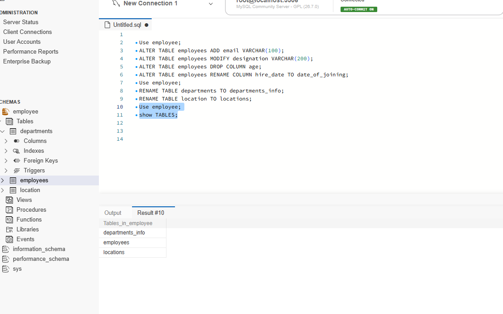
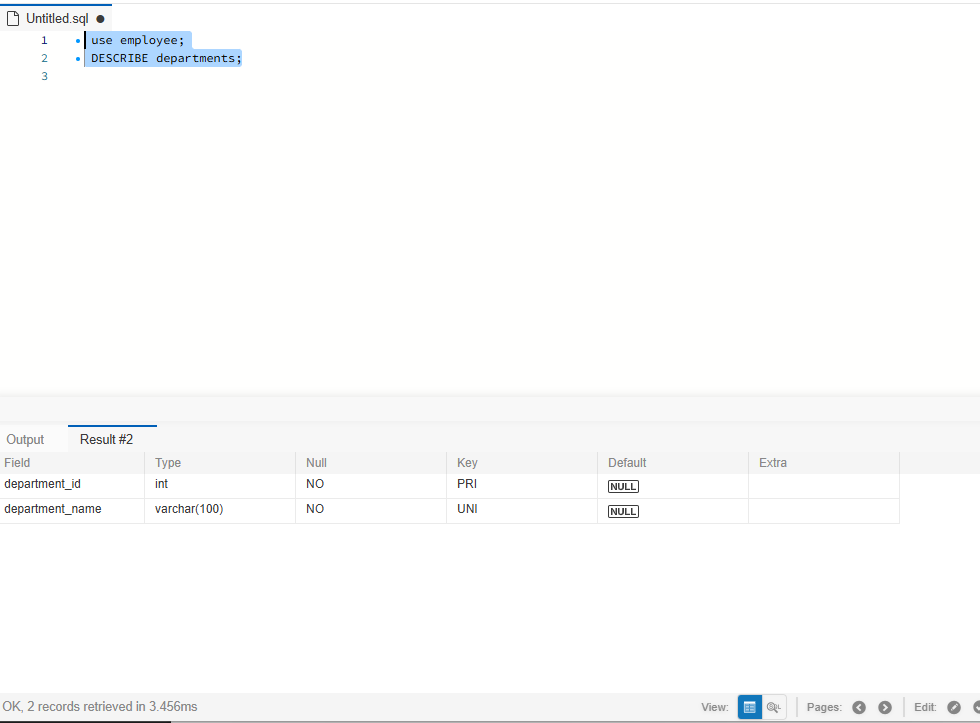
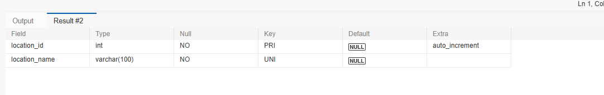
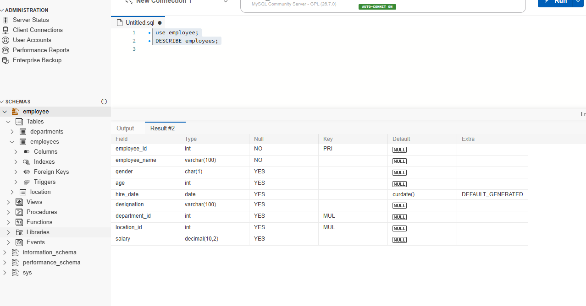

 SQL DDL Assignment - Employee Database

## 1. Objective
Create Employee Database with departments, location and employees tables using DDL Commands and perform ALTER, RENAME and TRUNCATE operations.

## 2. Database Created
CREATE DATABASE employee;
USE employee;

## 3. Tables Created

### a) departments Table
CREATE TABLE departments (
  department_id INT PRIMARY KEY AUTO_INCREMENT,
  department_name VARCHAR(100) UNIQUE NOT NULL
);

### b) location Table
CREATE TABLE location (
  location_id INT PRIMARY KEY AUTO_INCREMENT,
  location_name VARCHAR(100) UNIQUE NOT NULL
);

### c) employees Table
CREATE TABLE employees (
  employee_id INT PRIMARY KEY AUTO_INCREMENT,
  employee_name VARCHAR(100) NOT NULL,
  gender VARCHAR(10),
  age INT,
  hire_date DATE,
  designation VARCHAR(100),
  department_id INT,
  location_id INT,
  salary DECIMAL(10,2),
  FOREIGN KEY (department_id) REFERENCES departments(department_id),
  FOREIGN KEY (location_id) REFERENCES location(location_id)
);

## 4. ALTER TABLE Commands
ALTER TABLE employees ADD email VARCHAR(100);
ALTER TABLE employees MODIFY designation VARCHAR(150);
ALTER TABLE employees DROP COLUMN age;
ALTER TABLE employees RENAME COLUMN hire_date TO date_of_joining;

## 5. RENAME TABLE
RENAME TABLE departments TO departments_info;
RENAME TABLE location TO locations;

## 6. TRUNCATE TABLE
TRUNCATE TABLE employees;
SELECT * FROM employees;
-- Result: 0 records retrieved

## 7. Verification Commands
SHOW TABLES;
DESCRIBE departments_info;
DESCRIBE employees;
DESCRIBE locations;
SELECT * FROM employees;

## 8. Screenshots

### Screenshot 1 - ALTER and RENAME Commands

### Screenshot 2 - departments Table Structure

### Screenshot 3 - locations Table Structure

### Screenshot 4 - employees Table Structure

## 9. Conclusion
All DDL Commands - CREATE, ALTER, RENAME, TRUNCATE, DESCRIBE and SHOW TABLES are successfully executed on Employee Database.
